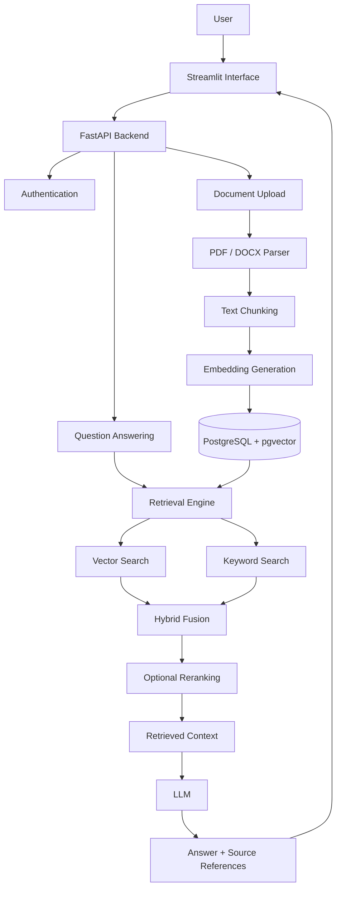
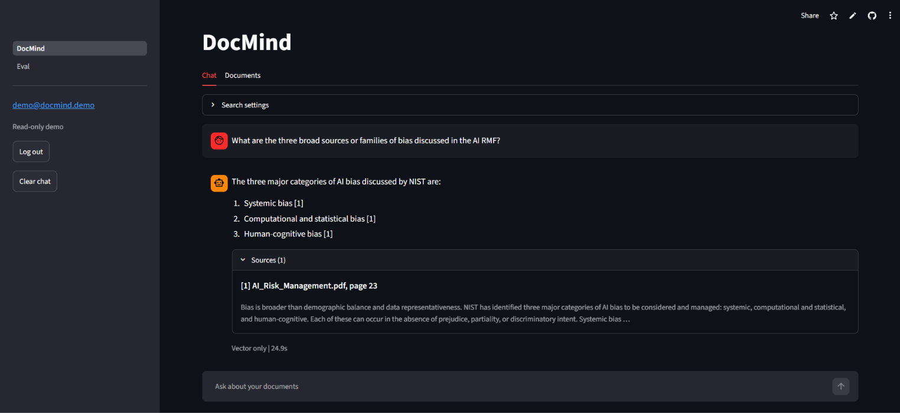
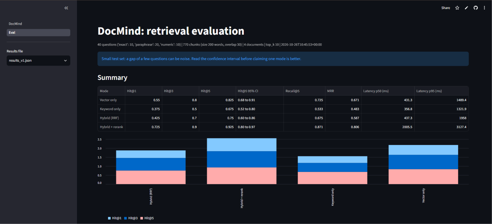
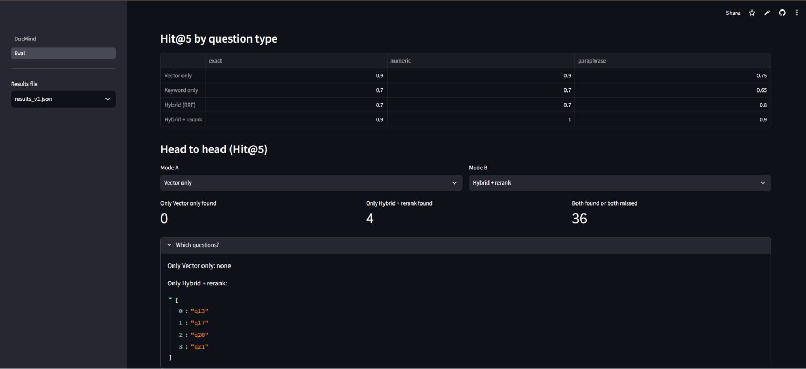

<div align="center">

# DocMind

### Document Intelligence | Retrieval-Augmented Generation | Retrieval Evaluation

**An end-to-end RAG system for document question answering, retrieval benchmarking, and evidence-grounded responses.**

[](https://www.python.org/)
[](https://fastapi.tiangolo.com/)
[](https://streamlit.io/)
[](https://www.postgresql.org/)
[](https://www.docker.com/)

[Live Application](https://docmindpy.streamlit.app) · [GitHub Repository](https://github.com/yatharth115/docmind)

</div>

---

## Overview

DocMind is a document question-answering system built using Retrieval-Augmented Generation (RAG).

It allows users to upload PDF and DOCX documents, retrieve relevant information, and generate answers grounded in document content with source references.

The project also includes an evaluation framework to compare different retrieval strategies using a manually prepared benchmark dataset.

Instead of relying entirely on an LLM's internal knowledge, DocMind retrieves relevant document chunks and uses them as context for answer generation.

## Features

- **PDF and DOCX ingestion:** Upload and process supported document formats.
- **Document parsing:** Extract text while preserving PDF page information and DOCX section context.
- **Text chunking:** Split documents into overlapping chunks while maintaining source metadata.
- **Vector search:** Retrieve semantically relevant content using embeddings.
- **Keyword search:** Search using PostgreSQL full-text search.
- **Hybrid retrieval:** Combine vector and keyword search using Reciprocal Rank Fusion (RRF).
- **Reranking:** Improve retrieval ordering using a cross-encoder reranker.
- **Grounded answers:** Generate responses using retrieved document context.
- **Source references:** Display relevant source excerpts and document locations.
- **User authentication:** JWT-based authentication with password hashing.
- **Document isolation:** Keep document access separated by user.
- **Evaluation dashboard:** Compare retrieval strategies using benchmark metrics.
- **Docker support:** Containerized backend and frontend deployment.
- **Deployment controls:** Read-only mode, registration controls, and configurable reranking.

## Architecture



## Technology Stack

| Component | Technology |
|---|---|
| Language | Python 3.12 |
| Backend | FastAPI |
| Frontend | Streamlit |
| Database | PostgreSQL |
| Vector Search | pgvector |
| ORM | SQLAlchemy |
| Migrations | Alembic |
| Embeddings | FastEmbed |
| Embedding Model | BAAI/bge-small-en-v1.5 |
| Reranking | FastEmbed TextCrossEncoder |
| Reranker Model | Xenova/ms-marco-MiniLM-L-6-v2 |
| LLM | Gemini API |
| Authentication | JWT + bcrypt |
| Document Parsing | PyMuPDF, python-docx |
| Deployment | Docker, Render, Streamlit Community Cloud |
| Evaluation | Custom Python evaluation framework |

## Retrieval Pipeline

DocMind implements four retrieval strategies.

### 1. Vector Search

Uses semantic embeddings to find document chunks based on meaning rather than exact keyword matches.

### 2. Keyword Search

Uses PostgreSQL full-text search with `websearch_to_tsquery` and `ts_rank_cd`.

A GIN index supports efficient keyword retrieval.

### 3. Hybrid Search

Combines vector and keyword retrieval using Reciprocal Rank Fusion.

The RRF implementation uses a constant of 60.

The fusion formula is:

\[
RRF(d) = \sum_{r \in R} \frac{1}{60 + rank_r(d)}
\]

### 4. Hybrid Search + Reranking

The hybrid retrieval stage retrieves candidate chunks, which are then reordered using a cross-encoder reranker.

This helps prioritize contextually relevant results, at the cost of additional processing time.

## Document Processing

| Setting | Value |
|---|---|
| Supported formats | PDF, DOCX |
| Chunk size | 200 words |
| Chunk overlap | 30 words |
| Chunk step | 170 words |
| Embedding dimensions | 384 |
| Retrieval candidates | 20 |
| Evaluation top-k | 10 |

Document processing preserves useful source metadata, including PDF page numbers, DOCX section context, and chunk indices.

**Current parsing limitations:**

- Scanned PDFs requiring OCR are not supported.
- DOCX tables are not currently extracted.
- Retrieval is primarily English-focused because of the selected embedding model and PostgreSQL text-search configuration.

## Evaluation Framework

DocMind includes a custom retrieval evaluation framework to compare the four retrieval strategies.

The benchmark uses:

- 40 manually prepared evaluation questions.
- 4 source PDF documents.
- 347 total document pages.
- 770 indexed chunks.
- 10 retrieved results per question.

### Benchmark Dataset

| Document | Pages | Chunks |
|---|---:|---:|
| AI Risk Management | 48 | 111 |
| Alienware | 158 | 257 |
| Llama | 77 | 274 |
| Philippines WHO | 64 | 128 |
| **Total** | **347** | **770** |

### Evaluation Metrics

- **Hit@K:** Whether a relevant document chunk appears within the top K results.
- **Recall@K:** Proportion of relevant chunks retrieved within the top K results.
- **MRR:** Mean Reciprocal Rank, measuring how highly the first relevant result appears.
- **p50 latency:** Median retrieval latency.
- **p95 latency:** 95th percentile retrieval latency.
- **95% confidence interval:** Estimated uncertainty around Hit@5.

### Benchmark Results

Results from the saved evaluation run:

| Retrieval Strategy | Hit@1 | Hit@5 | MRR | p50 Latency |
|---|---:|---:|---:|---:|
| Vector | 0.575 | 0.875 | 0.70 | 328 ms |
| Keyword | 0.375 | 0.675 | 0.49 | 241 ms |
| Hybrid | 0.425 | 0.825 | 0.61 | 334 ms |
| Hybrid + Reranking | **0.775** | **0.975** | **0.85** | 2013 ms |

### Key Observations

1. Hybrid retrieval with reranking achieved the highest Hit@1, Hit@5, and MRR in this benchmark.
2. Reranking improved Hit@1 from 0.575 to 0.775 compared with vector search.
3. Reranking also increased Hit@5 from 0.875 to 0.975.
4. The median retrieval latency increased from approximately 328 ms to 2013 ms.
5. Hybrid RRF without reranking did not outperform vector search in this particular benchmark.
6. Keyword retrieval had the lowest Hit@5 among the four strategies.

**Important:** These results represent a small benchmark of 40 questions across four documents. They should not be interpreted as proof of general performance across all document collections.

### Evaluation Limitations

- The benchmark contains only 40 questions and four source documents.
- Five gold-label corrections were made manually after reviewing evaluation failures.
- Some gold labels were informed by the top-five results of the retrieval strategies being evaluated, introducing potential selection bias.
- Confidence intervals overlap between vector search and reranking results, so the observed difference should not be treated as statistically conclusive.
- Reproducing the benchmark requires the original PDF corpus, which is not included in the repository.

## Screenshots

### Chat Interface



### Evaluation Dashboard



### Retrieval Comparison



## Project Structure

```text
docmind/
│
├── app/
│   ├── api/
│   │   ├── ask.py
│   │   ├── auth.py
│   │   ├── config_info.py
│   │   ├── deps.py
│   │   ├── documents.py
│   │   └── search.py
│   │
│   ├── core/
│   │   ├── config.py
│   │   └── security.py
│   │
│   ├── db/
│   │   ├── models.py
│   │   └── session.py
│   │
│   ├── services/
│   │   ├── chunking.py
│   │   ├── embedding.py
│   │   ├── fusion.py
│   │   ├── llm.py
│   │   ├── parsing.py
│   │   ├── prompting.py
│   │   ├── qa.py
│   │   ├── ratelimit.py
│   │   ├── rerank.py
│   │   └── retrieval.py
│   │
│   └── main.py
│
├── ui/
│   ├── pages/
│   │   └── Eval.py
│   ├── api_client.py
│   ├── helpers.py
│   └── DocMind.py
│
├── eval/
│   ├── results/
│   ├── apply_label_fixes.py
│   ├── audit_failures.py
│   ├── check_labels.py
│   ├── common.py
│   ├── corpus_meta.json
│   ├── ingest_corpus.py
│   ├── metrics.py
│   ├── questions.json
│   ├── questions.py
│   └── run_eval.py
│
├── tests/
│   ├── test_chunking.py
│   ├── test_deploy_flags.py
│   ├── test_eval_metrics.py
│   ├── test_fusion.py
│   ├── test_prompting.py
│   ├── test_tokens.py
│   └── test_ui_helpers.py
│
├── alembic/
├── docs/
│   └── screenshots/
├── scripts/
├── .devcontainer/
├── .dockerignore
├── .env.example
├── .gitignore
├── alembic.ini
├── docker-compose.yml
├── docker-compose.host.yml
├── Dockerfile
├── requirements.txt
└── README.md
```

## Getting Started

### Prerequisites

- Python 3.12
- PostgreSQL with the pgvector extension
- Docker and Docker Compose (for containerized setup)
- Gemini API key

### 1. Clone the Repository

```bash
git clone https://github.com/yatharth115/docmind.git
cd docmind
```

### 2. Create a Virtual Environment

Windows PowerShell:

```powershell
python -m venv .venv
.venv\Scripts\Activate.ps1
```

Linux / macOS:

```bash
python3 -m venv .venv
source .venv/bin/activate
```

### 3. Install Dependencies

```bash
pip install -r requirements.txt
```

### 4. Configure Environment Variables

Create a `.env` file using the example:

Windows PowerShell:

```powershell
Copy-Item .env.example .env
```

Linux / macOS:

```bash
cp .env.example .env
```

Configure the required values in `.env`:

```env
DATABASE_URL=your_postgresql_connection_string
SECRET_KEY=your_secure_secret_key
LLM_API_KEY=your_gemini_api_key
LLM_BASE_URL=https://generativelanguage.googleapis.com/v1beta/openai
LLM_MODEL=gemini-3.8-flash

ENABLE_RERANK=false
ALLOW_REGISTRATION=true
READ_ONLY_DOCS=false
```

Use the model name supported by your configured Gemini API account.

**Security:** Never commit your `.env` file or expose API keys, database credentials, or secret keys publicly.

### 5. Run Database Migrations

```bash
alembic upgrade head
```

Ensure that PostgreSQL has the pgvector extension installed and enabled.

### 6. Start the Backend

```bash
uvicorn app.main:app --reload
```

Backend API:

```text
http://localhost:8000
```

API documentation:

```text
http://localhost:8000/docs
```

### 7. Start the Streamlit Interface

Open another terminal, activate the virtual environment, and run:

```bash
streamlit run ui/DocMind.py
```

The application should now be available at:

```text
http://localhost:8501
```

## Running with Docker

DocMind also supports containerized deployment.

Configure the required environment variables and an external PostgreSQL database with pgvector.

Build and start the services:

```bash
docker compose up --build
```

The standard Compose setup starts:

- FastAPI backend on port 8000.
- Streamlit interface on port 8501.
- Database migrations during API startup.
- A persistent volume for uploaded documents.

The Compose configuration expects an externally hosted PostgreSQL database; it does not start a PostgreSQL container.

To stop the services:

```bash
docker compose down
```

To remove the Compose volumes as well:

```bash
docker compose down -v
```

**Warning:** Removing volumes can delete persisted uploaded documents.

The optional `docker-compose.host.yml` configuration is intended for host-network deployment environments. Windows users should generally use the standard Compose configuration.

## API Endpoints

| Method | Endpoint | Purpose |
|---|---|---|
| GET | `/health` | Health check |
| GET | `/config` | Public application configuration |
| POST | `/auth/register` | User registration |
| POST | `/auth/login` | User authentication |
| GET | `/documents` | List accessible documents |
| POST | `/documents/upload` | Upload a document |
| DELETE | `/documents/{id}` | Delete a document |
| POST | `/search` | Search document content |
| POST | `/ask` | Ask questions using RAG |

See the FastAPI interactive documentation at `/docs` for request schemas and additional details.

## Testing

Run the test suite from the project root:

```bash
python -m pytest -v
```

To run a specific test module:

```bash
python -m pytest tests/test_chunking.py -v
```

## Running the Evaluation

The evaluation framework is located in the `eval/` directory.

First, provide the original benchmark PDF documents in the expected evaluation corpus directory and configure the database.

Ingest the evaluation corpus:

```bash
python -m eval.ingest_corpus
```

Run the benchmark:

```bash
python -m eval.run_eval --top-k 10
```

Evaluation results are saved under:

```text
eval/results/
```

The evaluation scripts use the configured database and require the benchmark documents. The Docker image includes saved evaluation results but does not include the evaluation corpus or all evaluation runner scripts.

## Deployment

The public demo uses a resource-conscious configuration:

- Read-only document mode.
- New user registration disabled.
- Resource-intensive reranking disabled.

The local and Docker configurations can enable additional retrieval strategies and reranking when sufficient resources are available.

**Live Demo:** [DocMind Application](https://docmindpy.streamlit.app)

The deployment uses free-tier hosting resources, so cold starts, memory constraints, and service availability limitations may affect response times.

## Engineering Decisions

Some implementation decisions were made to keep the system understandable, modular, and independently testable.

- **No LangChain or LlamaIndex:** Core RAG components were implemented directly to understand document processing, retrieval, fusion, prompting, and evaluation.
- **PostgreSQL + pgvector:** A single database supports relational data, vector search, and keyword retrieval.
- **Modular retrieval:** Vector, keyword, hybrid, and reranking stages can be evaluated separately.
- **Source-aware chunking:** Page and section metadata are preserved to support traceable answers.
- **Fallback LLM configuration:** The application supports a fallback model when the primary LLM request encounters retryable failures.
- **Evaluation-driven development:** Retrieval strategies are compared using explicit metrics rather than relying only on subjective answer quality.

## Current Limitations

- Scanned PDF OCR is not implemented.
- DOCX table extraction is not implemented.
- Retrieval is primarily English-focused.
- The evaluation benchmark is relatively small.
- Reranking increases retrieval latency.
- Rate limiting is implemented in memory and is not distributed across multiple application instances.
- Chat history is session-based rather than persistently stored.
- Free-tier deployment resources can limit performance and availability.

## Future Improvements

Potential improvements include:

- OCR support for scanned PDFs.
- DOCX table extraction.
- Larger and more diverse evaluation datasets.
- Improved benchmark annotation methodology.
- Distributed rate limiting.
- Persistent chat history.
- More robust observability and monitoring.
- Additional embedding and reranking model comparisons.
- Expanded multilingual retrieval support.

## Learning Outcomes

Building DocMind provided practical experience with:

- Retrieval-Augmented Generation architecture.
- Embeddings and vector similarity search.
- PostgreSQL full-text search and pgvector.
- Reciprocal Rank Fusion.
- Cross-encoder reranking.
- LLM API integration and fallback handling.
- FastAPI backend development.
- JWT authentication and access control.
- Document parsing and chunking.
- Retrieval evaluation and benchmark analysis.
- Docker-based application deployment.
- Testing and modular Python development.

## Author

**Yatharth Joshi**

Computer Science Engineering | AI & Machine Learning

- GitHub: [@yatharth115](https://github.com/yatharth115)
- Project: [DocMind](https://github.com/yatharth115/docmind)
- Live Demo: [docmindpy.streamlit.app](https://docmindpy.streamlit.app)

---

<div align="center">

**Built as a hands-on exploration of Retrieval-Augmented Generation and document intelligence.**

</div>
